<div align="center">

# Westpac Personalised Home

### An AI-driven banking home page that builds itself around you

**Made by team Who's Json for the Westpac Hackathon 2026**


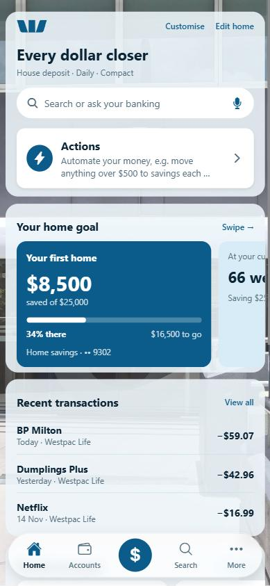
&nbsp;&nbsp;
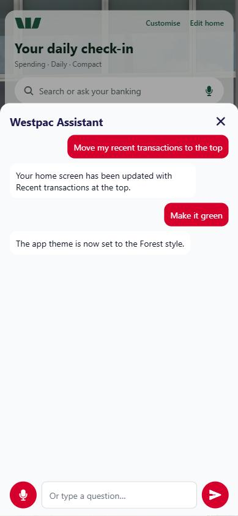
&nbsp;&nbsp;
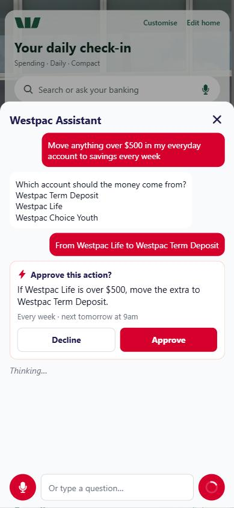

</div>

---

## The idea

Every customer opens the same banking app, but nobody uses it the same way. A first home buyer wants to see
their deposit grow. Someone paying off a credit card wants to watch the debt shrink. A daily checker wants
yesterday's coffee at the top.

**Westpac Personalised Home** is a proof of concept where the home screen adapts to the person:

- 🧭 **7 quick questions** pick from 10 widget templates and build a Home screen to match your goal and habits.
- 🗣️ **A voice and chat assistant** answers banking questions and edits Home for you: *"put my bills at the top"*, *"make it green"*.
- ⚡ **Actions**: tell the AI *"if my everyday account has more than $500, move the extra to savings every week"* and it sets up the automation, after you approve it.
- 🛡️ **Safe by design**: the AI only works through the app's API, never sees balances or transactions, and every money rule needs your approval. All its permissions live in one readable file, [`ai_perms.md`](ai_perms.md).

## Walkthrough

### 1. Sign in and start from the standard home

<table>
  <tr>
    <td align="center" width="25%">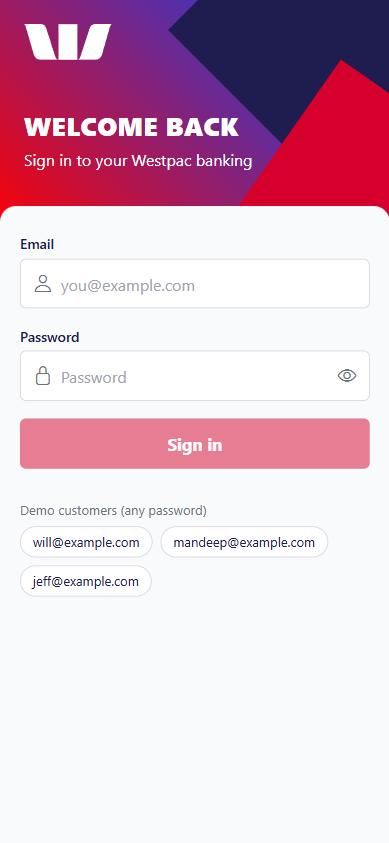<br /><sub><b>Sign in</b><br />pick a demo customer by email</sub></td>
    <td align="center" width="25%">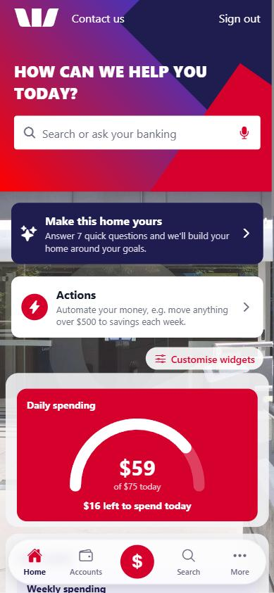<br /><sub><b>Standard Westpac home</b><br />with a "Make this home yours" invite</sub></td>
    <td align="center" width="25%">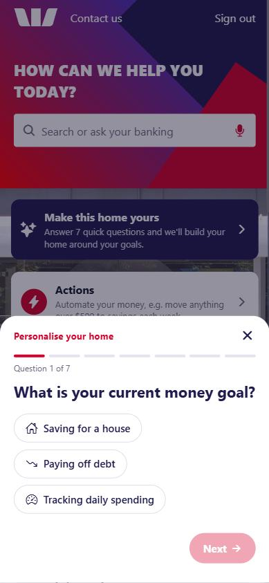<br /><sub><b>Question 1</b><br />what's your money goal?</sub></td>
    <td align="center" width="25%">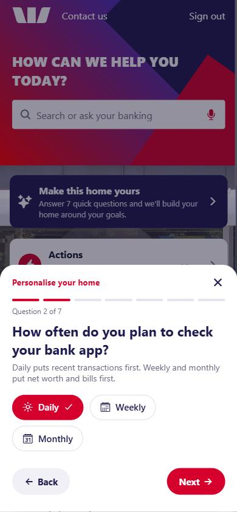<br /><sub><b>Question 2</b><br />how often do you check in?</sub></td>
  </tr>
</table>

### 2. Answer 7 questions, get a home that's yours

<table>
  <tr>
    <td align="center" width="25%">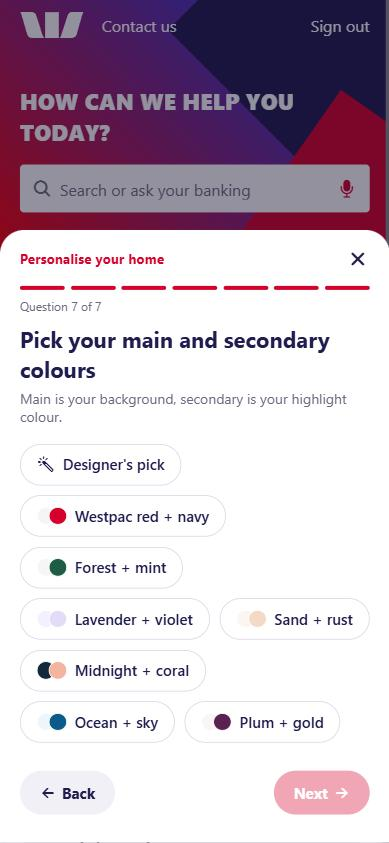<br /><sub><b>Pick your colours</b><br />main and accent theme</sub></td>
    <td align="center" width="25%">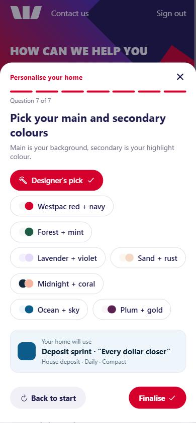<br /><sub><b>Preview and finalise</b><br />the best of 10 templates</sub></td>
    <td align="center" width="25%"><br /><sub><b>House saver home</b><br />deposit tracker up front</sub></td>
    <td align="center" width="25%">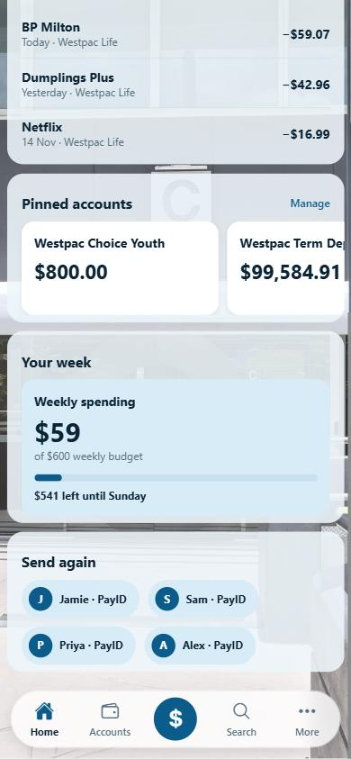<br /><sub><b>Your tweaks</b><br />pinned accounts, weekly spend, PayID contacts</sub></td>
  </tr>
</table>

### 3. Change it yourself, or just ask

<table>
  <tr>
    <td align="center" width="33%">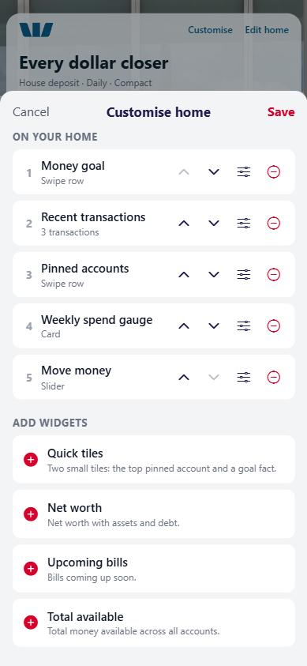<br /><sub><b>Customise by hand</b><br />move, remove, add and restyle widgets</sub></td>
    <td align="center" width="33%"><br /><sub><b>Or ask the AI</b><br />"move my recent transactions to the top", "make it green"</sub></td>
    <td align="center" width="33%">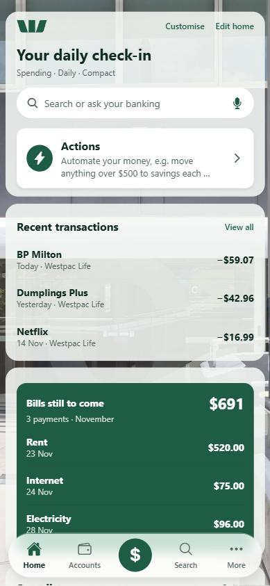<br /><sub><b>Done</b><br />the Forest theme, saved to your profile</sub></td>
  </tr>
</table>

### 4. Let the AI automate your money, with you in control

<table>
  <tr>
    <td align="center" width="25%">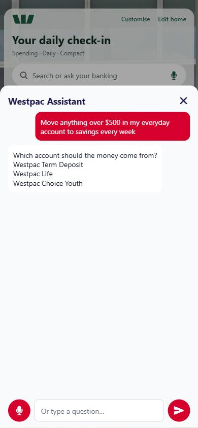<br /><sub><b>It never guesses</b><br />missing an account, amount or time frame? It asks</sub></td>
    <td align="center" width="25%"><br /><sub><b>You approve</b><br />every new or changed rule</sub></td>
    <td align="center" width="25%">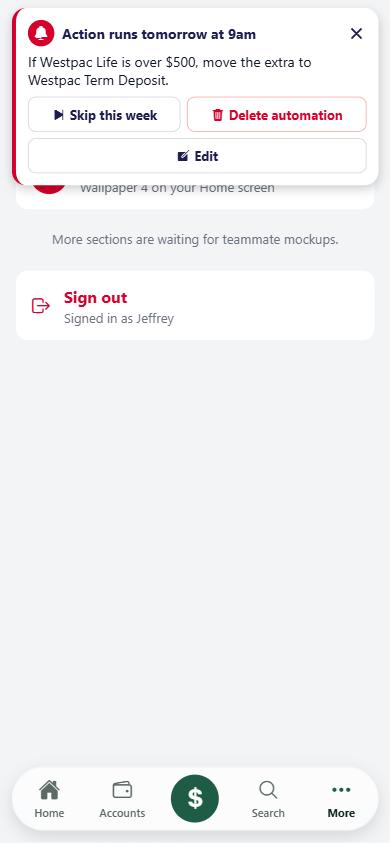<br /><sub><b>Heads-up first</b><br />skip, edit or delete before it runs</sub></td>
    <td align="center" width="25%">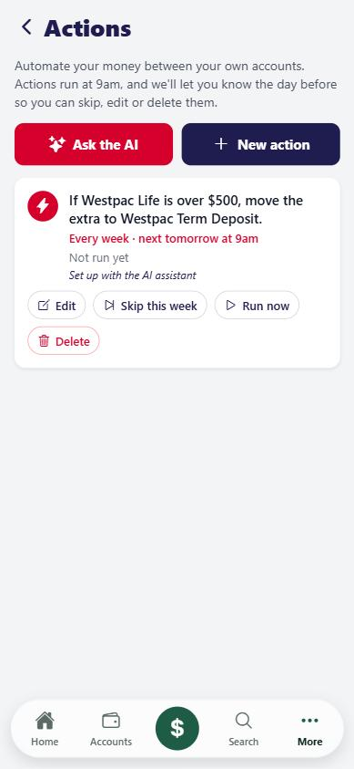<br /><sub><b>All your Actions</b><br />run now, skip, edit, delete</sub></td>
  </tr>
</table>

### 5. Make it look like home

<table>
  <tr>
    <td align="center" width="33%">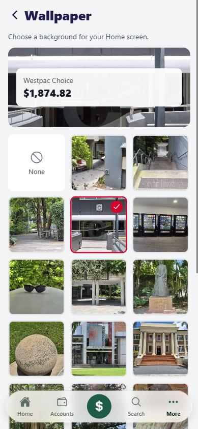<br /><sub><b>Wallpapers</b><br />a background behind your widgets, with frosted panels so it stays readable</sub></td>
  </tr>
</table>

## Features

| Feature | What it does |
| --- | --- |
| **Personalised home** | 7 questions → 10 templates (4 from our Figma mockups). Mixes Netflix-style carousel rows with stacked widgets. Goal, check-in frequency, pinned accounts, weekly tracker, contacts vs. transfers, density and colours all change the layout. |
| **9 widgets** | Money goal (house deposit / debt paid off / daily spend gauge), weekly spend gauge, pinned accounts, quick tiles, recent transactions, net worth, upcoming bills, move money (PayID contacts or a 1-tap transfer slider) and total available. Many come in several styles (carousel, grid, list...). |
| **AI assistant** | Type or speak (Groq Whisper speech-to-text + LLM chat with tool calling). Banking questions only, plain-text replies. |
| **AI home editing** | Adds, removes and moves widgets and changes the theme on request, using only widgets and themes listed in the database. |
| **Actions** | Sweep (move anything over a threshold), top up (keep an account above a minimum) or fixed transfers, daily / weekly / monthly. Created by you or the AI, never overdraws, alerts you before each run. |
| **Manual editing** | A widget editor to reorder, remove, add and restyle widgets without the AI. |
| **Wallpapers** | 23 backgrounds behind the home screens, saved per user. |
| **Persistence** | Theme, widgets (with their styles), wallpaper and Actions are saved in SQLite and restored on sign-in. |
| **Glass tab bar** | A floating, translucent tab bar that takes on your theme colours. |

## Responsible AI

The assistant's rules are written in plain English in [`ai_perms.md`](ai_perms.md) and imported straight into its
system prompt, so anyone (not just developers) can read and change what the AI is allowed to do. Highlights:

- ✅ Can see widget **names and order**, theme names, account **names** and Action rules.
- ❌ Never sees balances, transactions or spending categories. Those go to the widgets only.
- ❌ No direct SQL or write access. Every change goes through the app's rate-limited API.
- ❌ Can't read credentials, touch security settings, approve loans or raise credit limits.
- ✋ Every automation it creates or changes waits for the user to **Approve** or **Decline**, and the user is
  alerted before each run.
- 🏦 Banking questions only. Anything else is politely declined.

## How it works

```
                 ┌────────────────────────── Expo app (iOS · Android · Web) ──────────────────────────┐
  voice / text → │  AssistantSheet ──► Groq (Whisper + LLM)                                          │
                 │        │   tools: add/remove/move_widget, set_theme, create/edit/delete_action     │
                 │        ▼                                                                           │
                 │  buildHome(answers) ──► templates + widgets ──► PersonalisedHome                  │
                 │        │                                                                           │
                 └────────┼───────────────────────────────────────────────────────────────────────────┘
                          ▼  REST (rate-limited, session user only)
                 database/server.mjs  ──►  SQLite: users · accounts · transactions · themes ·
                 (runs due Actions          widgets · homepage_widgets · customisation ·
                  every minute)             actions · action_runs · session
```

**Tech:** Expo SDK 58 · React Native 0.88 · React 19 · expo-blur · react-native-svg · expo-audio ·
Groq (`whisper-large-v3-turbo`, `openai/gpt-oss-120b`, `qwen/qwen3.8-27b`) · Node's built-in `node:sqlite` ·
`node:test`.

## Getting started

```bash
npm install
cp .env.example .env   # add your Groq key as EXPO_PUBLIC_GROQ_API_KEY
npm run db             # terminal 1: the database API on port 3001
npm start              # terminal 2: or npm run web / npm run android / npm run ios
```

Sign in with any demo customer's email from `database/app.db` (any password works, it's a demo). The app still
runs without `npm run db`, but nothing is saved and the widgets show mock data. If a phone can't reach the API,
set `EXPO_PUBLIC_DB_URL` in `.env`. On web the mic needs https or localhost.

> [!WARNING]
> **Hackathon only.** `EXPO_PUBLIC_` variables are bundled into the app, so the Groq key can be extracted by
> anyone who has it. A real build would call Groq from a backend, with real authentication.

### Tests

```bash
npm test
```

`node:test`, no device needed: action rules, the scheduler and AI action tools; the Groq client, tool loop and
rate-limit retry; templates and `buildHome`; the widget editor; wallpapers; and the database API against an
in-memory copy of `schema.sql`.

## Project structure

```
App.js                 tabs (manual navigation, no Expo Router), sign-in gate, action alerts, glass tab bar
ai_perms.md            the AI's rules, imported straight into its system prompt
components/            GlassTabBar, WestpacLogo
screens/               SignIn, Home, More (+ Accounts, Payments, Search placeholders)
src/personalise/       questions, templates, buildHome, widgets, themes, widget editor, wallpapers, AI home tools
src/actions/           automation rules, Actions page, approval card, alerts, AI action tools
src/voice/             Groq speech-to-text + chat, tool-calling loop, assistant sheet
src/db/client.js       the database API client
database/              schema.sql, app.db, server.mjs (API + Action scheduler)
presentation/          hackathon slides and screenshots
tests/                 node:test suites
```

More detail for developers is in [`CLAUDE.md`](CLAUDE.md).

## What's next

- Build out the Accounts, Payments and Search tabs (placeholders in this proof of concept).
- Real bills, goals, budgets, joint accounts and PayID contacts from the bank (mock data for now).
- Push notifications for Actions, and let the AI pick wallpapers.
- Move the Groq calls to a backend and add real authentication.

---

<div align="center">

### Made with ❤️ by team **Who's Json**

Built for the **Westpac Hackathon 2026**

<sub>A proof of concept. Not a real Westpac product, no real customer data, and no real money moves.</sub>

</div>
